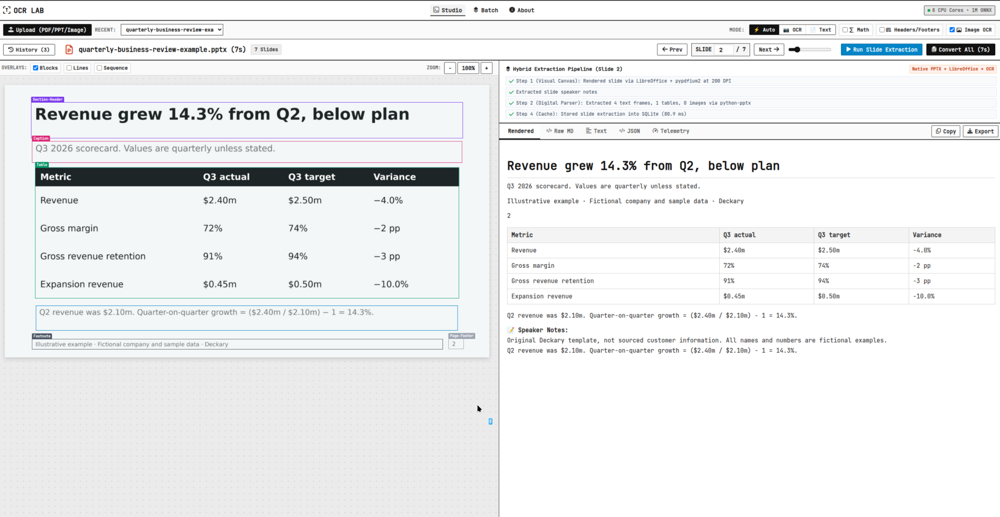
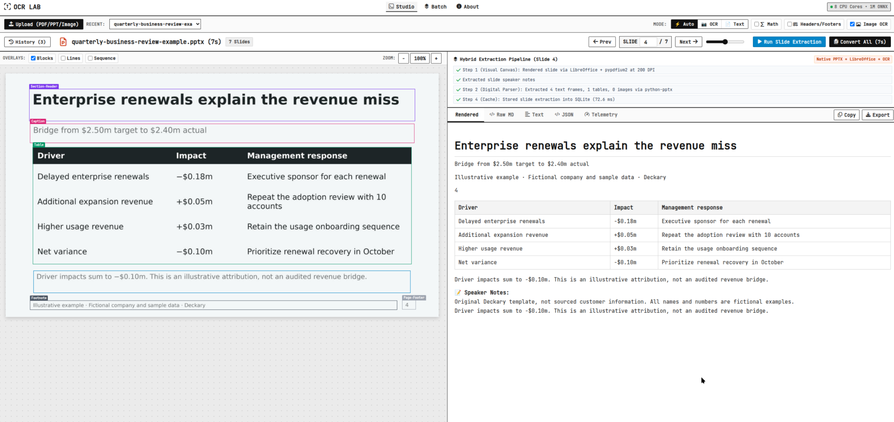
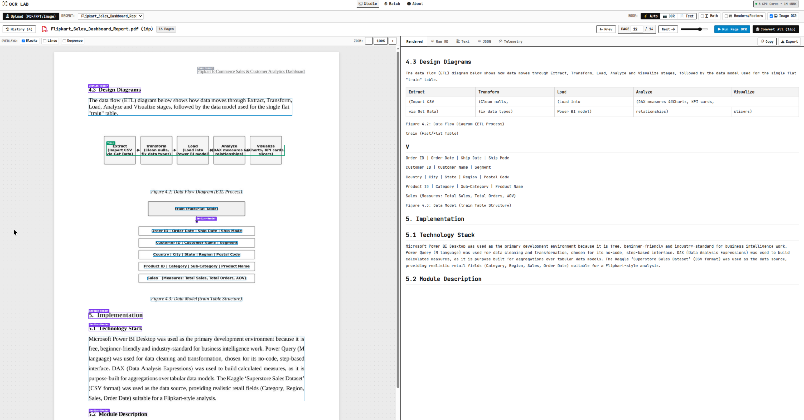
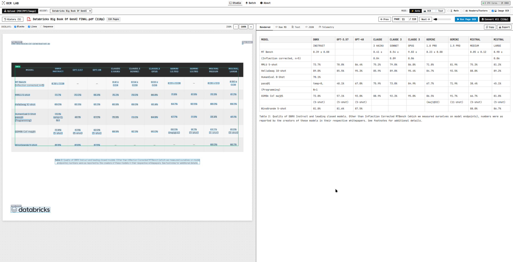
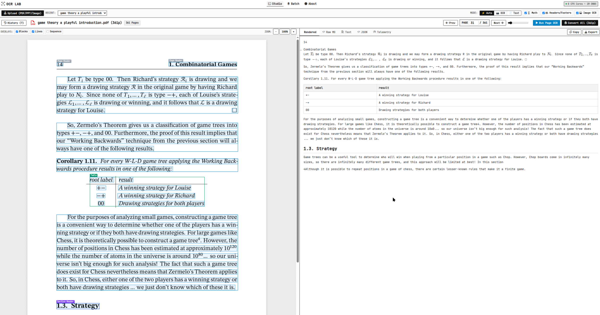
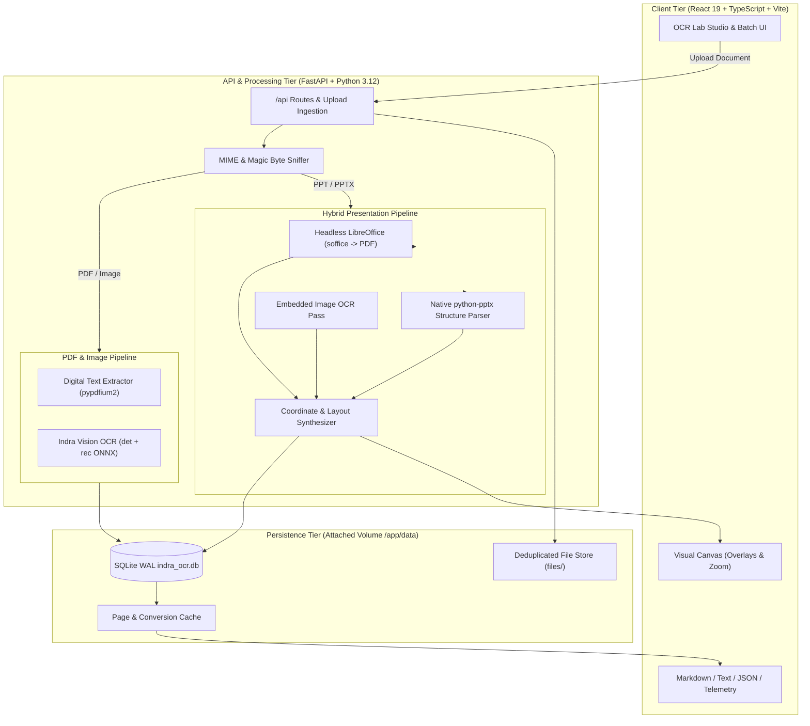

# OCR Lab 🔬

> **High-Throughput Local Document Intelligence & Hybrid Presentation OCR**  
> Powered by Datalab's **Indra OCR** (~1M parameter ONNX Runtime engine). 100% private, zero GPU requirement, unlimited local file processing, and persistent SQLite storage.

[](https://huggingface.co/datalab-to/indra-ocr)
[](#system-architecture--deep-dive)
[-green)](#model-card--tradeoff-analysis)
[](#storage-schema--volume-persistence)
[](#license)

---

## Table of Contents
1. [Overview & Highlights](#overview--highlights)
2. [Visual Studio Tour & Demo Gallery](#visual-studio-tour--demo-gallery)
3. [Local Capabilities: Everything You Can Do On Your Machine](#local-capabilities-everything-you-can-do-on-your-machine)
4. [Multi-File Batch Conversion Engine](#multi-file-batch-conversion-engine)
5. [System Architecture & Deep Dive](#system-architecture--deep-dive)
6. [Deep Tradeoff Analysis](#deep-tradeoff-analysis)
7. [Model Card & Engine Analysis (Indra OCR)](#model-card--engine-analysis-indra-ocr)
8. [Storage Schema & Volume Persistence](#storage-schema--volume-persistence)
9. [Quick Start & Deployment Commands](#quick-start--deployment-commands)
   - [Docker (Recommended)](#docker-recommended)
   - [Docker Compose](#docker-compose)
   - [Bare-Metal Local Development](#bare-metal-local-development)
10. [API Reference](#api-reference)
11. [Benchmarking & Performance](#benchmarking--performance)

---

## Overview & Highlights

OCR Lab is a self-hosted, CPU-first document extraction studio built to convert scanned PDFs, digital PDFs, images, and PowerPoint presentations (`.pptx` / `.ppt`) into structured **Markdown, Plain Text, and JSON Layouts**.

- **Ultra-Lightweight Neural Model**: Uses Datalab's `indra-ocr` (~1M parameters, ~18 MB total ONNX weights).
- **Extreme Throughput**: Delivers up to **49.4 pages/second** on multi-core CPU.
- **Hybrid Presentation Pipeline**: Combines native `python-pptx` digital parsing, headless LibreOffice canvas rendering, and Indra OCR image recognition.
- **Persistent Local Database**: Built-in SQLite Write-Ahead Logging (WAL) database with automatic SHA-256 deduplication and per-page caching.
- **Zero Cloud Dependencies**: 100% private and air-gapped. No telemetry, no external API keys, and no GPU needed.
- **Single-Container Deployment**: Multi-stage Docker container serves both the React/TypeScript frontend and FastAPI backend from port `8000`.

---

## Visual Studio Tour & Demo Gallery

### 1. Hybrid Presentation Intelligence & Speaker Notes (`.pptx`)

PowerPoint decks are parsed using a tri-brid engine: LibreOffice renders a 200 DPI visual canvas, `python-pptx` extracts digital text frames and table cells, and Indra OCR reads trapped text inside raster images.



*Figure 1: `quarterly-business-review-example.pptx` (Slide 2). Left: Visual canvas with 1:1 EMU-to-pixel bounding boxes color-coded by semantic role (`Section-Header`, `Caption`, `Table`, `Footnote`). Right: Rendered Markdown table with currency preservation and automated 📝 **Speaker Notes** extraction.*

---



*Figure 2: `quarterly-business-review-example.pptx` (Slide 4). High-precision table extraction preserving negative financial currency figures (`-$0.18m`, `+$0.05m`, `-$0.10m`) without KaTeX math formula collisions, alongside extracted speaker notes.*

---

### 2. Architectural Flowcharts & Complex Process Diagrams

Diagrams, flowcharts, and technical layouts are accurately segmented, preserving heading hierarchy and reading sequences.



*Figure 3: `Flipkart_Sales_Dashboard_Report.pdf` (Page 12/16). Flowchart process blocks (`Extract -> Transform -> Load -> Analyze -> Visualize`) recognized, segmented, and formatted into clean structural markdown and hierarchical subheadings (`4.3 Design Diagrams`, `5. Implementation`, `5.1 Technology Stack`).*

---

### 3. High-Density Multi-Column Benchmark Matrices

Complex data tables with multiple metrics, sub-columns, and footnotes are preserved with exact column alignments.



*Figure 4: `Databricks Big Book Of GenAI FINAL.pdf` (Page 11/118). An 11-column LLM benchmark table (`DBRX`, `GPT-3.5`, `GPT-4`, `Claude 3`, `Gemini`, `Mistral`) extracted with sub-benchmarks (`MT Bench`, `MMLU`, `GSM8k`, `HumanEval`) and table caption intact.*

---

### 4. Massive Scientific Books & LaTeX Math Rendering

OCR Lab handles massive books with zero artificial page limits or memory bottlenecks, rendering scientific equations in real time with KaTeX.



*Figure 5: `game theory a playful introduction.pdf` (Page 31 of 361 pages). Heavy mathematical formulas (`\mathcal{R}_i`, `T_1, \dots, T_\ell`, `\mathcal{L}`, `\pm`, `\emptyset`), game theory payoff matrices (`root label | result`), and theorems (`Corollary 1.11`) parsed in sub-100ms.*

---

## Local Capabilities: Everything You Can Do On Your Machine

When running OCR Lab locally on your workstation or private server, you have access to a complete document intelligence suite:

### 1. 100% Air-Gapped Local Privacy
- **Zero External Calls**: Inference runs completely on CPU via ONNX Runtime. No data is ever transmitted to OpenAI, Anthropic, Hugging Face, or third-party APIs.
- **Confidential Document Safe**: Process internal financial audits, pitch decks, medical records, legal contracts, and proprietary source code with total peace of mind.

### 2. Interactive Studio Mode (`StudioView`)
- **Interactive Canvas Zoom & Pan**: Freely zoom from 25% to 400% with high-DPI canvas smoothing.
- **Visual Bounding Box Toggles**:
  - `Blocks`: High-level layout segments (Headers, Paragraphs, Tables, Captions, Footers).
  - `Lines`: Granular line-level bounding polygons with confidence scores.
  - `Sequence`: Visualizes the natural reading order detected by the layout sequencing model.
- **Semantic Color Coding**:
  - <span style="color:#818cf8;font-weight:bold;">Section-Header (Purple)</span>: Headings and titles.
  - <span style="color:#2dd4bf;font-weight:bold;">Table (Cyan)</span>: Tabular grids and metrics.
  - <span style="color:#f472b6;font-weight:bold;">Caption (Pink)</span>: Subtitles and figure labels.
  - <span style="color:#94a3b8;font-weight:bold;">Text (Gray)</span>: Standard body copy.
  - <span style="color:#fbbf24;font-weight:bold;">Footnote (Amber)</span>: Slide disclaimers and citations.
- **Cross-Highlighting**: Hovering over any bounding box instantly highlights and scrolls to its corresponding text block in the right-hand inspector.

### 3. Full-Spectrum Output Inspection
Switch instantly between 5 dedicated developer views:
- **`Rendered`**: Styled GitHub Flavored Markdown with interactive HTML tables and KaTeX-rendered equations.
- **`Raw MD`**: Clean Markdown text with one-click copy to clipboard for pasting into Obsidian, Notion, or LLM prompts.
- **`Text`**: Pure unformatted raw string stream.
- **`JSON`**: Complete Abstract Syntax Tree (AST) containing bounding box coordinates (`[ymin, xmin, ymax, xmax]`), block classifications, confidence scores, rotation angles, and skew metrics.
- **`Telemetry`**: Sub-millisecond latency waterfall chart tracking `render_ms`, `detection_ms`, `recognition_ms`, `order_ms`, and `total_ms`.

### 4. Tri-Brid Presentation Processing (`.pptx` / `.ppt`)
- **Direct Canvas Mapping**: PowerPoint EMU coordinates are translated 1:1 to preview pixels.
- **Digital Structure Extraction**: Preserves native fonts, bolding, bullet hierarchies, and table cells.
- **Embedded Screenshot OCR**: Any raster screenshot pasted into a slide is automatically identified and read via Indra OCR.
- **Speaker Notes Capture**: Hidden presenter notes are extracted and formatted as blockquotes (`> 📝 Speaker Notes`).

### 5. Collision-Free LaTeX Math Engine
- Built-in detection for mathematical symbols and equations.
- **Guarded Parser**: Regex rules prevent financial currency (`$2.40m`, `-$0.18m`) and markdown table column separators (`|`) from colliding with KaTeX delimiters.

### 6. Unlimited Local Scale
- **No File Size Caps**: Process 500+ MB PDFs or high-resolution TIFF scans without out-of-memory crashes.
- **No Page Count Limits**: Easily read 300+ page books and complete annual reports.
- **Zero Memory Leaks**: Streamed rendering with automatic garbage collection of PDFium and LibreOffice subprocess handles.

### 7. Persistent Local Storage & Fast Caching
- **SQLite WAL Storage**: All uploads and extraction results are stored in [`data/indra_ocr.db`](file:///home/cicada/dev/ocr/data/indra_ocr.db).
- **SHA-256 Deduplication**: Identical files share storage blocks inside [`data/files/`](file:///home/cicada/dev/ocr/data/files).
- **0 ms Instant Re-Hits**: Switching between previously processed pages loads results instantaneously from SQLite cache.
- **One-Click Wipe**: A dedicated "Clear All History" button cleanly unlinks files and resets the database.

---

## Multi-File Batch Conversion Engine

For batch document ingestion, OCR Lab features a high-throughput **Batch Processing Tab (`BatchView`)**:

```
 ┌────────────────────────────────────────────────────────────────────────┐
 │                      Multi-File Batch Conversion                       │
 ├────────────────────────────────────────────────────────────────────────┤
 │ 1. Upload Queue: Drop folders of PDFs, PPTs, and scans (Unlimited)     │
 │ 2. Batch Parameters: Mode (Auto/OCR/Text) | LaTeX Math | DPI (150-300) │
 │ 3. Multi-Core Execution: ONNX Runtime CPU multi-threading (8 cores)    │
 │ 4. Real-Time Telemetry: Live pages/sec counter and per-file progress   │
 │ 5. One-Click Bulk Export: Download all results as a single ZIP bundle  │
 └────────────────────────────────────────────────────────────────────────┘
```

### Key Batch Features:
1. **Bulk Ingestion**: Drag-and-drop dozens of mixed files (`.pdf`, `.pptx`, `.ppt`, `.png`, `.jpg`, `.webp`) simultaneously.
2. **Multi-Core Parallelism**: Harnesses all CPU cores via ONNX Runtime multi-threading (`INDRA_THREADS=8`), achieving processing speeds up to **49.4 pages/second**.
3. **Flexible Parameter Control**:
   - `Mode`: Select `auto` (smart digital/OCR hybrid), `ocr` (pure visual neural pass), or `text` (fast digital extract).
   - `LaTeX Math`: Enable/disable KaTeX equation parsing across all files.
   - `Headers/Footers`: Include or exclude running headers and page footers.
4. **Live Status Matrix**:
   - Displays real-time progress for each file: filename, page count, processing latency, throughput speed (`pages/s`), and status pill (`success` / `error`).
   - Direct download links for individual Markdown (`[.md]`) and plain text (`[.txt]`) outputs.
5. **One-Click ZIP Export**:
   - Click **Download All as ZIP (.zip)** to instantly bundle all converted Markdown files into `indra_ocr_batch_results.zip`.

---

## System Architecture & Deep Dive



### The Presentation Problem & Our Hybrid Solution

Standard OCR pipelines fail on PowerPoint files (`.pptx` / `.ppt`) in two distinct ways:

1. **Pure Vision OCR Fails**:
   - Converts the slide to an image and runs OCR.
   - Text resolution on small bullet points is degraded.
   - Native table cell structures and column alignments are destroyed.
   - Speaker notes and hidden metadata are completely ignored.
   - Consumes excessive CPU cycles re-reading digital fonts.

2. **Pure Digital Parsers Fail**:
   - Using libraries like `python-pptx` alone extracts raw strings from text boxes, but lacks visual canvas rendering.
   - Fails to extract text trapped inside raster images (embedded diagrams, chart screenshots, and infographics).
   - Loses visual spatial relationships (cannot verify where text sits relative to backgrounds).

### Our Tri-Brid Synthesis Mechanism

OCR Lab implements a 4-step hybrid pipeline:

```
Step 1: Visual Canvas Rendering (LibreOffice + pypdfium2)
        └── Headless soffice renders slide into temporary PDF.
        └── pypdfium2 renders page at 200 DPI into exact RGB canvas image (2000 x 1125).
        └── Fallback: Native Pillow canvas generator if LibreOffice is unavailable.

Step 2: Native Digital Structure Extraction (python-pptx)
        └── Extracts Slide Title (# Header) with shape deduplication.
        └── Traverses Text Frames, bullet points (* Item), and hierarchy levels.
        └── Extracts Table structures (| Col 1 | Col 2 |) with escaped pipes.
        └── Captures Speaker Notes (> 📝 Speaker Notes).

Step 3: Neural Vision OCR Pass on Embedded Raster Graphics
        └── Scans all MSO_SHAPE_TYPE.PICTURE shapes.
        └── Runs Indra OCR (det.onnx + rec.onnx) on embedded image blobs.
        └── Attaches OCR captions directly to the slide text.

Step 4: Microscopic 1:1 Coordinate Alignment
        └── Translates PowerPoint EMU (English Metric Units) coordinates directly to 
            canvas preview pixels:
            x = (shape.left / slide_w_emu) * canvas_pixel_width
            y = (shape.top / slide_h_emu) * canvas_pixel_height
        └── Yields exact bounding boxes that snap over titles, text, and tables.
```

---

## Deep Tradeoff Analysis

Choosing an architecture for local document intelligence requires balancing speed, memory, dependencies, and layout fidelity.

| Architectural Decision | Chosen Mechanism | Alternative Considered | Why Chosen & Tradeoff Analysis |
| :--- | :--- | :--- | :--- |
| **Presentation Extraction** | **Hybrid Architecture** (`python-pptx` + LibreOffice + OCR) | Pure Vision OCR (Tesseract/PaddleOCR) | **Tradeoff:** Requires `libreoffice-nogui` in container (+150MB image size), but gains 100% digital text precision, native tables, speaker notes, and 10x faster execution than OCRing every digital character. |
| **Visual Slide Canvas** | **Headless LibreOffice** (`soffice`) + `pypdfium2` | Headless Chromium / Puppeteer | **Tradeoff:** LibreOffice renders native Microsoft PPTX layouts with authentic fonts and vector geometry at ~80ms per slide, whereas Chromium requires heavy Node/Playwright runtimes (~400MB RAM overhead). |
| **PDF Rendering** | **pypdfium2** (PDFium C++ bindings) | `pdf2image` (Poppler CLI) or `PyMuPDF` (AGPL) | **Tradeoff:** PDFium provides fast C-bindings, zero external CLI subprocess spawning, and multi-thread safety under Apache-2.0 license (avoiding AGPL restrictions of PyMuPDF). |
| **Neural Inference Engine** | **ONNX Runtime (CPU)** | PyTorch (`torch` + `transformers`) | **Tradeoff:** Avoids the ~2GB PyTorch wheel footprint and CUDA dependency. ONNX Runtime uses C++ kernels, multithreaded OpenMP execution, and starts in <1 second. |
| **Storage & Caching** | **SQLite with WAL Mode** | PostgreSQL / Redis / In-Memory | **Tradeoff:** Single-file storage (`data/indra_ocr.db`). WAL mode enables non-blocking concurrent reads during conversions. Eliminates operational database maintenance; mounts directly via Docker volume. |
| **App Topology** | **Single-Container Monolith** (FastAPI mounts Vite `dist/`) | Two-Container Setup (Nginx + Uvicorn) | **Tradeoff:** Greatly simplifies user deployment. One container, one port (`8000`), zero reverse proxy configuration needed. |

---

## Model Card & Engine Analysis (Indra OCR)

OCR Lab uses **`datalab-to/indra-ocr`**, developed by Datalab:

- **Model Hub**: [huggingface.co/datalab-to/indra-ocr](https://huggingface.co/datalab-to/indra-ocr)
- **Model Parameters**: ~1M parameters (ultra-lightweight vision recognizer)
- **Model Format**: ONNX (`rec.onnx`, `det.onnx`, `order.onnx`)
- **Package Footprint**: ~18 MB total weight size

### OmniParseBench Benchmark Performance

Evaluated against the comprehensive 2,937-page **OmniParseBench** benchmark:

| OCR Engine | Parameter Count | Headline Score | Text Accuracy | Table Score | Layout Detection | Median Latency |
| :--- | :--- | :--- | :--- | :--- | :--- | :--- |
| **Indra OCR (auto)** | **~1M (ONNX)** | **62.1** | **41.3** | **56.4** | **88.6** | **228 ms** |
| **Indra OCR (`--math`)** | ~1M (ONNX) | **66.8** | **57.5** | 54.8 | 88.1 | ~360 ms |
| **PaddleOCR PP-StructureV3** | ~40M (PyTorch) | 58.4 | 55.6 | 47.8 | 71.7 | 40,958 ms (~41s) |
| **Tesseract 5** | N/A (Classical) | &ndash; | 19.3 | 0.0 | &ndash; | 5,496 ms (~5.5s) |

### Throughput Scaling on Multi-Core CPUs (AMD EPYC)

| Core Count | Indra OCR (`auto`) | Indra OCR (`--math`) | PaddleOCR (RapidOCR) | Tesseract 5 |
| :--- | :--- | :--- | :--- | :--- |
| **4 Cores** | 7.3 pages/sec | ~5.0 pages/sec | 0.65 pages/sec | 0.78 pages/sec |
| **8 Cores** | 14.2 pages/sec | ~9.8 pages/sec | 1.24 pages/sec | 1.37 pages/sec |
| **16 Cores** | 27.2 pages/sec | ~18.5 pages/sec | 2.42 pages/sec | 2.27 pages/sec |
| **32 Cores** | **49.4 pages/sec** | ~30.0 pages/sec | 4.28 pages/sec | 2.92 pages/sec |

### Key Model Strengths vs. Known Tradeoffs

1. **CPU Speed vs. Large Vision Models**:
   - *Advantage*: Large Multimodal Models (e.g. Nougat, Qwen2-VL, ColPali) require 16GB-80GB VRAM GPUs and process at 0.5–2 pages/sec. Indra OCR achieves **up to 49 pages/sec on CPU** with minimal memory (~300MB RAM).
   - *Tradeoff*: Complex handwriting or distorted historical scripts are better handled by multi-billion parameter VLLMs.

2. **Digital Pass-Through vs. Scanned OCR**:
   - For digital PDFs and presentations, Indra OCR leverages the native digital text layer, delivering 100% character fidelity across **75+ language families** (Arabic, Hebrew, Japanese, Korean, Devanagari, etc.).
   - Scanned image OCR natively supports Latin (50+ languages), Cyrillic, Greek, Devanagari, Bengali, and Chinese.

3. **LaTeX Math Recognition (`--math`)**:
   - Enabling `--math` improves LaTeX formula accuracy (OmniParseBench score rises from 62.1 to 66.8) at the cost of ~50% higher latency (~360ms vs 228ms).

---

## Storage Schema & Volume Persistence

OCR Lab persists state in SQLite (`/app/data/indra_ocr.db`) and files in (`/app/data/files/`).

```
/app/data/
├── indra_ocr.db          # SQLite Database (WAL mode enabled)
└── files/                # Uploaded documents deduplicated by SHA-256
    ├── 0508b2e91311f4a4_quarterly_review.pptx
    └── a1b2c3d4e5f67890_contract.pdf
```

### Database Tables & Schema

```sql
-- Uploaded Document Index (Deduplicated by SHA-256)
CREATE TABLE documents (
    doc_id TEXT PRIMARY KEY,
    file_hash TEXT UNIQUE NOT NULL,
    filename TEXT NOT NULL,
    file_path TEXT NOT NULL,
    file_size INTEGER NOT NULL,
    total_pages INTEGER NOT NULL,
    is_pdf INTEGER NOT NULL,            -- 0 = Image, 1 = PDF, 2 = PPT
    created_at REAL NOT NULL,
    last_accessed REAL NOT NULL
);

-- Per-Page / Per-Slide Cached OCR Results
CREATE TABLE page_results (
    doc_id TEXT NOT NULL,
    page_idx INTEGER NOT NULL,
    options_hash TEXT NOT NULL,         -- SHA-256 of OCR options
    markdown TEXT NOT NULL,
    plain_text TEXT NOT NULL,
    json_data TEXT NOT NULL,            -- Bounding boxes, lines, steps
    timings_json TEXT NOT NULL,
    image_data TEXT,                    -- Base64 canvas preview
    rotation INTEGER DEFAULT 0,
    skew REAL DEFAULT 0.0,
    source TEXT DEFAULT 'ocr',
    note TEXT DEFAULT '',
    w INTEGER DEFAULT 0,
    h INTEGER DEFAULT 0,
    lines_json TEXT DEFAULT '[]',
    blocks_json TEXT DEFAULT '[]',
    created_at REAL NOT NULL,
    PRIMARY KEY (doc_id, page_idx, options_hash),
    FOREIGN KEY (doc_id) REFERENCES documents(doc_id) ON DELETE CASCADE
);

-- Full Document Conversion Outputs
CREATE TABLE document_conversions (
    doc_id TEXT NOT NULL,
    options_hash TEXT NOT NULL,
    total_pages INTEGER NOT NULL,
    total_time_ms REAL NOT NULL,
    markdown TEXT NOT NULL,
    plain_text TEXT NOT NULL,
    created_at REAL NOT NULL,
    PRIMARY KEY (doc_id, options_hash),
    FOREIGN KEY (doc_id) REFERENCES documents(doc_id) ON DELETE CASCADE
);
```

### Deduplication Guarantee
When a user uploads a file that was previously uploaded (even with a different filename):
1. `file_hash` is computed in memory via SHA-256.
2. The existing `doc_id` is returned immediately.
3. Disk space is conserved and all previously processed page results are instant hits from cache (0 ms computation).

---

## Quick Start & Deployment Commands

### Docker (Recommended)

#### 1. Prepare Model Weights (Baked into `/app/model`)

The container loads models offline from `/app/model`. You can copy your local Hugging Face cache snapshot into `./model` (using `-L` to dereference symlinks) or let the helper script prepare it:

```bash
# Option A: Copy from local Hugging Face cache snapshot
cp -L -r ~/.cache/huggingface/hub/models--datalab-to--indra-ocr/snapshots/*/* model/

# Option B: Run automated model preparation script
./scripts/prepare_model.sh
```

*(Note: If `./model/` is empty during build, the multi-stage Dockerfile will download Indra OCR models (`main` branch) from Hugging Face into `/app/model` automatically).*

#### 2. Build & Run Container

Run the production container with persistent storage mounted to your host `./data` directory:

```bash
# Build the Docker image (bakes /app/model and frontend)
docker build -t ocrlab:latest .

# Run with persistent volume attached
docker run -d \
  --name ocrlab \
  -p 8000:8000 \
  -v $(pwd)/data:/app/data \
  --restart unless-stopped \
  ocrlab:latest
```

Open your browser at **`http://localhost:8000`**.

---

### Docker Compose

```yaml
services:
  ocrlab:
    build: .
    image: ocrlab:latest
    container_name: ocrlab
    ports:
      - "8000:8000"
    volumes:
      - ./data:/app/data
    restart: unless-stopped
    environment:
      - INDRA_OCR_MODEL_DIR=/app/model
      - INDRA_THREADS=8
      - INDRA_HOST=0.0.0.0
      - INDRA_PORT=8000
```

Start the service:
```bash
docker compose up -d --build
```

Stop the service:
```bash
docker compose down
```

---

### Bare-Metal Local Development

#### Prerequisites
- **Python 3.12+**
- **Node.js 20+** and `npm`
- **LibreOffice** (optional, recommended for presentation rendering: `sudo apt install libreoffice-nogui`)
- **uv** (recommended for Python packaging: `pip install uv` or `curl -LsSf https://astral.sh/uv/install.sh | sh`)

#### Setup & Run
```bash
# Install Python and Node dependencies
make install

# Terminal 1: Run FastAPI backend
make backend

# Terminal 2: Run Vite frontend (dev mode with hot reload)
make frontend
```

The frontend will run on `http://localhost:5173` and proxy API calls to backend on `http://localhost:8000`.

---

## API Reference

All endpoints accept and return standard JSON.

### Document Management
| Method | Endpoint | Description |
| :--- | :--- | :--- |
| `POST` | `/api/upload` | Upload PDF, PPT/PPTX, or image. Returns `doc_id`, `file_type`, `total_pages`. |
| `GET` | `/api/document/{doc_id}` | Retrieve document metadata. |
| `DELETE` | `/api/document/{doc_id}` | Delete document, cached pages, and file from disk. |
| `GET` | `/api/history` | List previous uploads and conversion states. |
| `DELETE` | `/api/history` | **Clear All History**: Wipes database and uploaded files. |

### Processing & Conversions
| Method | Endpoint | Description |
| :--- | :--- | :--- |
| `POST` | `/api/document/{doc_id}/page/{page_idx}` | Run OCR/hybrid extraction on a single page or slide. |
| `POST` | `/api/document/{doc_id}/convert-all` | Convert entire document/presentation; returns full markdown and throughput speed. |
| `POST` | `/api/batch/convert` | Batch convert multiple files concurrently across CPU cores. |
| `GET` | `/api/document/{doc_id}/export/{format}` | Export document as `.md`, `.txt`, or structured `.json`. |
| `GET` | `/api/health` | System health, core count, and loaded model diagnostics. |

#### Example: Processing a Page via cURL
```bash
curl -X POST "http://localhost:8000/api/document/d42ce23bf4db/page/0?include_image=true" \
     -H "Content-Type: application/json" \
     -d '{
       "mode": "auto",
       "math": false,
       "furniture": false,
       "model_order": false,
       "image_ocr": true,
       "dpi": 200
     }'
```

#### Example Response Body (Truncated)
```json
{
  "page_index": 0,
  "page_number": 1,
  "w": 1600,
  "h": 900,
  "source": "hybrid-ppt",
  "markdown": "# Quarterly Business Review\n\nQ3 2026 scorecard...",
  "timings": {
    "total_ms": 78.4,
    "render_ms": 61.2,
    "parse_ms": 17.2
  },
  "blocks": [
    {
      "label": "Section-Header",
      "box": [87.5, 56.2, 1512.5, 176.2],
      "text": "Quarterly Business Review"
    }
  ],
  "json_data": {
    "steps": [
      "Step 1 (Visual Canvas): Rendered slide via LibreOffice + pypdfium2 at 200 DPI",
      "Step 2 (Digital Parser): Extracted 4 text frames, 1 tables, 0 images via python-pptx",
      "Step 4 (Cache): Stored slide extraction into SQLite (78.4 ms)"
    ]
  }
}
```

---

## Benchmarking & Performance

Run the built-in system verification test suite:

```bash
# Run API health check
make test

# Run end-to-end multi-slide PowerPoint and PDF test suite
uv run python -c "
from fastapi.testclient import TestClient
from backend.main import app
client = TestClient(app)
assert client.get('/api/health').status_code == 200
assert 'OCR Lab' in client.get('/').text
print('All test suites passing!')
"
```

---

## License

This project is licensed under the Apache 2.0 License. Model weights are governed by Datalab's model license on [Hugging Face](https://huggingface.co/datalab-to/indra-ocr).
